# EDA - cityscapes

- root: `data/synthetic_cityscapes`
- classes: 19  (ignore index 255)

## Splits

| split | images | domains | mean classes/img | mean ignore | imbalance max/min | never seen |
|---|---|---|---|---|---|---|
| train | 54 | 6 | 7.70 | 0.010 | 419.1 | wall, fence, traffic light, terrain, rider, truck, bus, train, motorcycle |
| val | 18 | 6 | 7.22 | 0.010 | 459.8 | wall, fence, traffic light, terrain, rider, truck, bus, train, motorcycle |
| test | 24 | 2 | 7.71 | 0.010 | 373.1 | wall, fence, traffic light, terrain, rider, truck, bus, train, motorcycle |

Normalization suggestion from `train`: mean=[0.44440001249313354, 0.30390000343322754, 0.4514000117778778], std=[0.23399999737739563, 0.15850000083446503, 0.22110000252723694]

## Class table (train)

| idx | class | pixel share | image presence | median-freq weight |
|---|---|---|---|---|
| 0 | road | 37.6576% | 100.0% | 0.09 |
| 1 | sidewalk | 16.0919% | 100.0% | 0.22 |
| 2 | building | 23.2374% | 100.0% | 0.15 |
| 3 | wall | 0.0000% | 0.0% | 0.00 |
| 4 | fence | 0.0000% | 0.0% | 0.00 |
| 5 | pole | 0.4361% | 74.1% | 8.08 |
| 6 | traffic light | 0.0000% | 0.0% | 0.00 |
| 7 | traffic sign | 0.0899% | 42.6% | 39.22 |
| 8 | vegetation | 4.4626% | 100.0% | 0.79 |
| 9 | terrain | 0.0000% | 0.0% | 0.00 |
| 10 | sky | 14.8167% | 100.0% | 0.24 |
| 11 | person | 0.4534% | 46.3% | 7.77 |
| 12 | rider | 0.0000% | 0.0% | 0.00 |
| 13 | car | 2.5863% | 68.5% | 1.36 |
| 14 | truck | 0.0000% | 0.0% | 0.00 |
| 15 | bus | 0.0000% | 0.0% | 0.00 |
| 16 | train | 0.0000% | 0.0% | 0.00 |
| 17 | motorcycle | 0.0000% | 0.0% | 0.00 |
| 18 | bicycle | 0.1681% | 38.9% | 20.96 |

## Continual tasks

- T0: aachen, bochum
- T1: bremen, cologne
- T2: darmstadt, dusseldorf

## Classes absent per domain

- aachen: wall, fence, traffic light, terrain, rider, truck, bus, train, motorcycle
- bochum: wall, fence, traffic light, terrain, rider, truck, bus, train, motorcycle, bicycle
- bremen: wall, fence, traffic light, terrain, person, rider, truck, bus, train, motorcycle
- cologne: wall, fence, traffic light, traffic sign, terrain, rider, truck, bus, train, motorcycle, bicycle
- darmstadt: wall, fence, traffic light, terrain, rider, truck, bus, train, motorcycle
- dusseldorf: wall, fence, traffic light, terrain, person, rider, truck, bus, train, motorcycle

## Figures

### Images per split
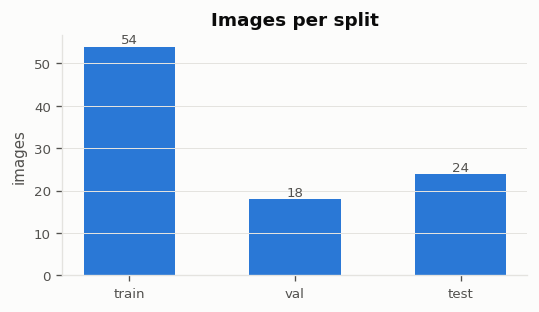

### Images per domain and split
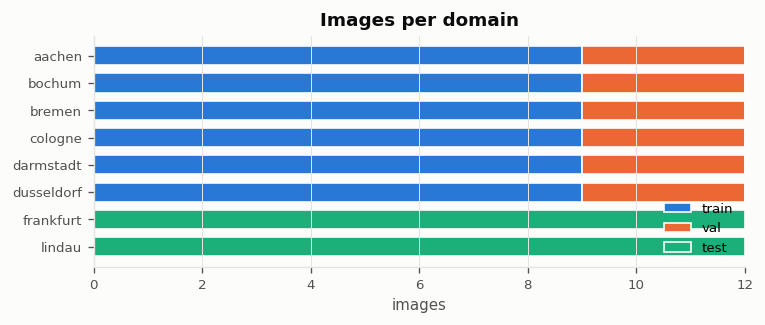

### Class pixel share (train, log scale)
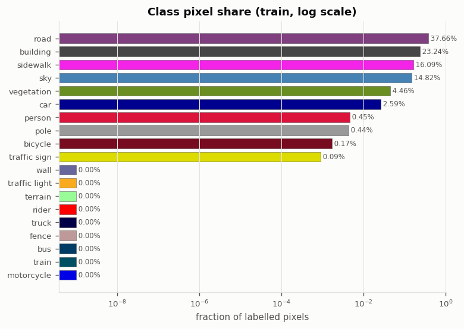

### Images containing each class (train)
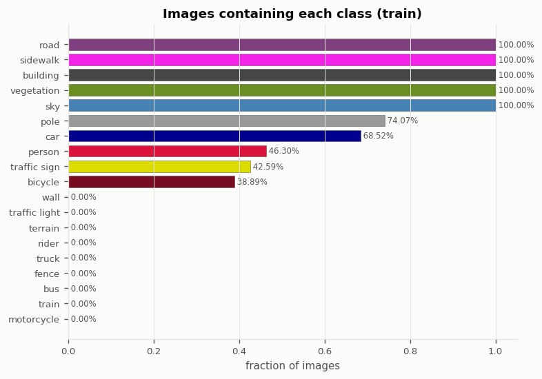

### Class pixel share by split
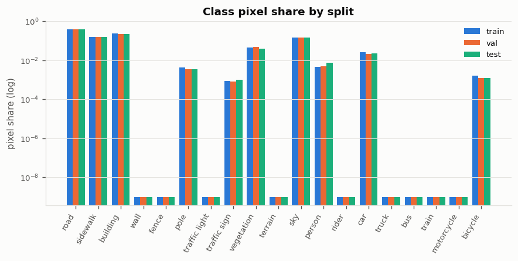

### Pixel count per class index
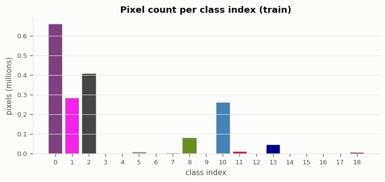

### Class area per image when present
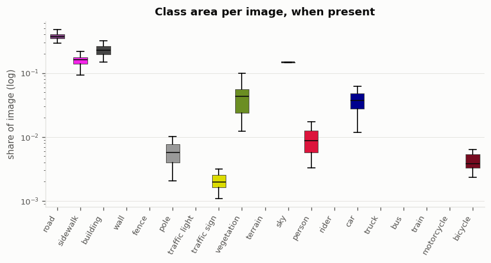

### Classes per image and ignore-label share
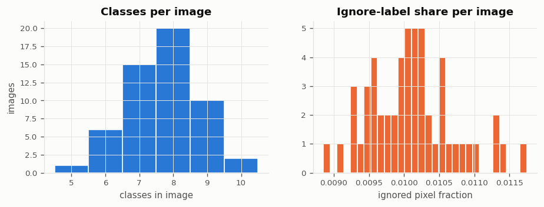

### Class pixel share per domain (train)
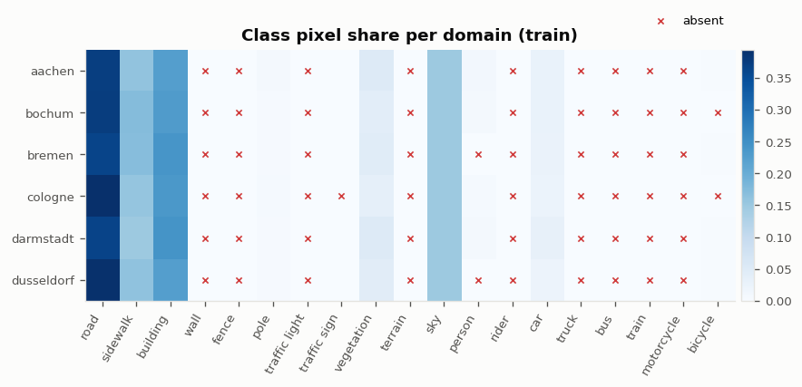

### Class presence per domain (train)
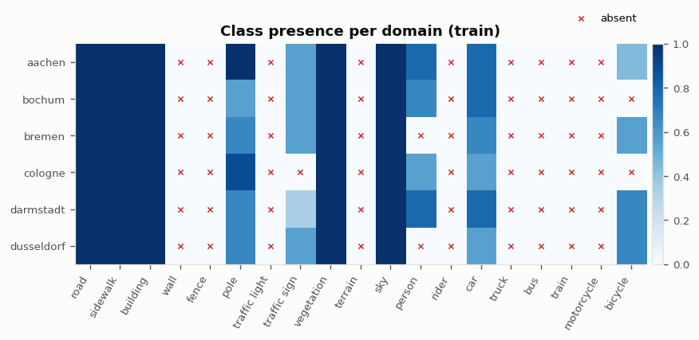

### Class pixel share per continual task
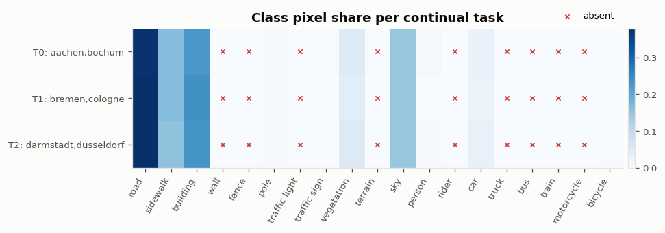

### Class co-occurrence
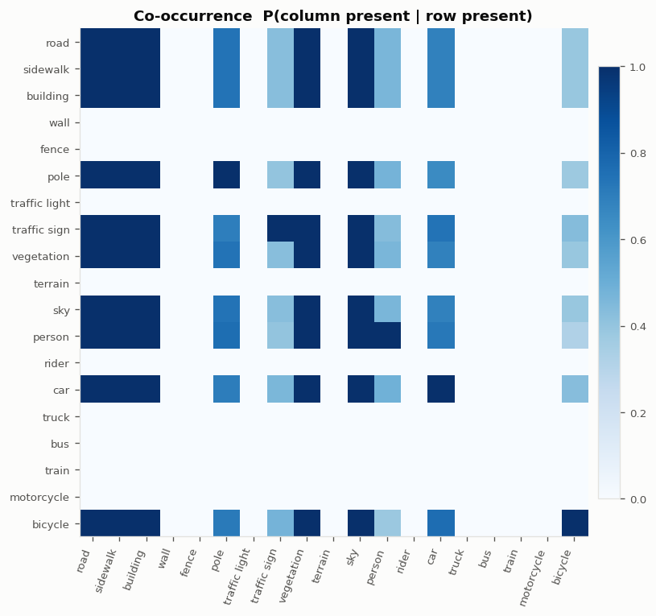

### Spatial class priors
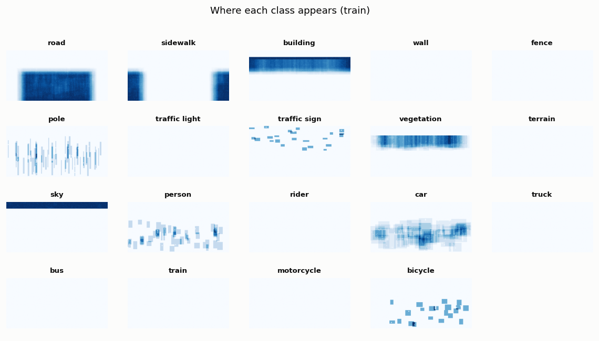

### RGB intensity and image resolution
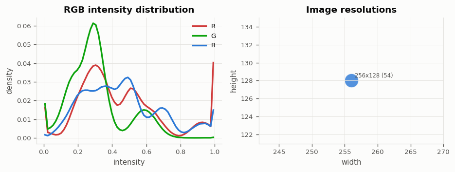

### Brightness per domain
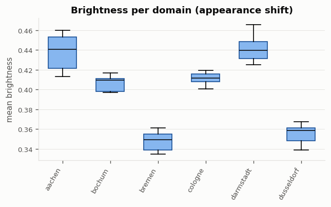

### Sample images with label overlay
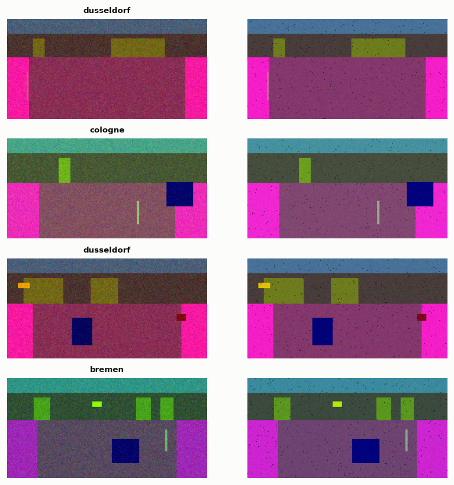

### Class index and color legend
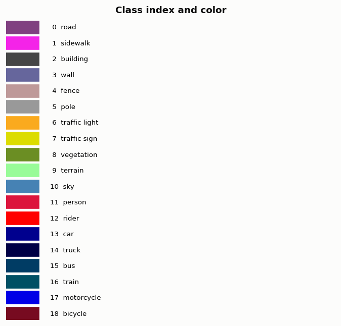
